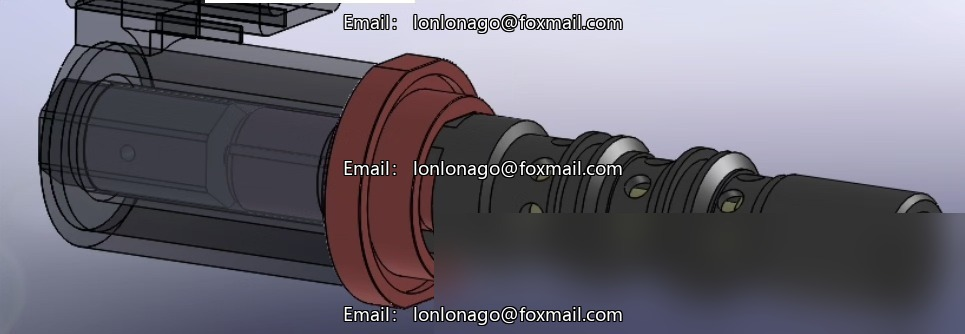
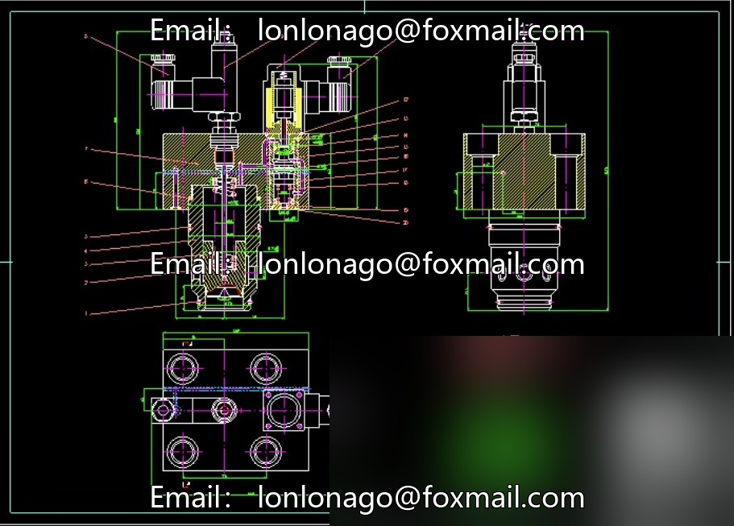

# Electro-hydraulic proportional valve design; Electro-hydraulic proportional valve design drawing; Electro-hydraulic proportional valve design CAD drawing

## Body

Electro-hydraulic proportional valve design; Electro-hydraulic proportional valve design drawing; Electro-hydraulic proportional valve design CAD drawing
Hydraulic-electrical proportional regulation valve design; hydraulic-electrical proportional regulation valve design diagram; hydraulic-electrical proportional regulation valve design CAD diagram
This material contains 2 three-dimensional drawings, and 1 CAD drawing plus adjustment valve design material and specification

The material includes two three-dimensional diagrams, one CAD diagram and a manual for valve design, with the figure number annotated as 542.

<!-- AI_ENRICHED -->

## Images

## Payment

Here is a pay link on Stripe ( https://buy.stripe.com/3cs8yP7sY87d0vu9AB ). Please contact me lonlonago@foxmail.com after funding $89, and I will send you a complete data files , thank you!

